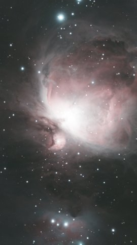
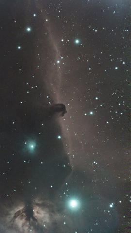
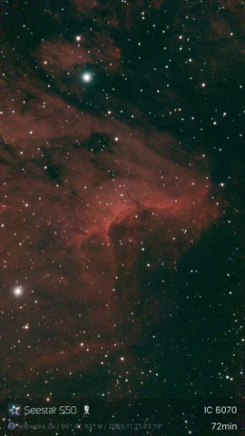
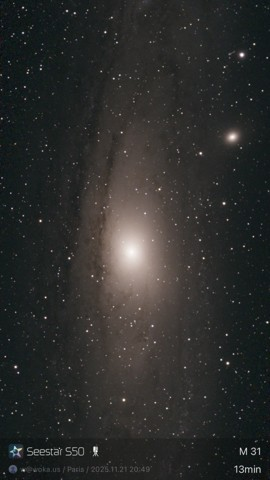

# Astronomy

Public writeups and reference material from my amateur astrophotography setup - currently a
ZWO Seestar S50 running remotely at [Starfront Observatories](https://starfront.space/), with
a larger 11" rig in planning.

## Projects in here

- **[Automating a Seestar S50 with N.I.N.A.](nina-automation.md)** - driving the S50 through
  a real astrophotography sequencer (N.I.N.A.) via its HTTP API instead of the stock Seestar
  app, with a scheduler that plans a whole night across multiple targets. Includes the real
  story of chasing down why compact targets kept coming up empty despite hours of
  integration.
- **[C11 EdgeHD imaging train spec sheet](scope_specs.md)** - full parts list and backfocus
  stack for a second, larger rig (Celestron EdgeHD 11" on a ZWO AM7 mount) currently being
  planned as a permanent remote setup.

## Related repos

- **[seestar_battery_monitor](https://github.com/wokka1/seestar_battery_monitor)** - reads
  the Seestar S50's battery/power telemetry over its own native protocol (separate from the
  ASCOM/Alpaca layer NINA talks to, which has no battery data at all). Runs alongside the
  NINA automation above, on the same remote setup.

## Images

Click any thumbnail for the full-resolution image.

More to come - the NINA automation writeup above covers a real bug hunt that just got fixed
(2026-08), so the setup is only now producing properly-focused, properly-centered subs
worth sharing.
